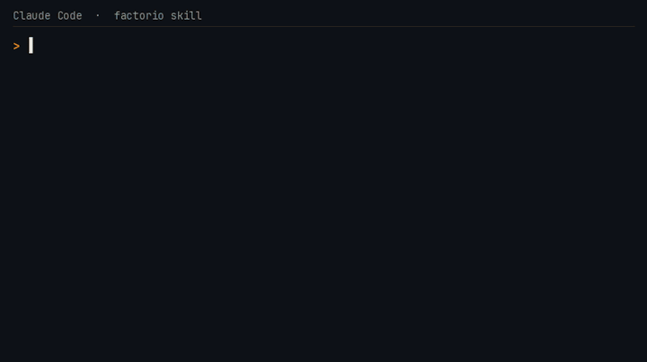

# Skill de Factorio para Claude Code

**Planos que se prueban antes de pegarlos.** Una skill de [Claude Code](https://claude.com/claude-code)
para Factorio 2.0 que responde con los archivos reales de tu juego y ejecuta una copia sin gráficos del
juego para comprobar lo que hace, en vez de fiarse de lo que recuerda de la 1.1.

[Read in English](README.md)

<!--  -->

## Qué hace

- **Diseña planos y demuestra que funcionan.** Claude escribe un generador, dibuja el diseño y lo
  construye en un Factorio aislado sin gráficos: alimenta las cintas y mide la producción por minuto. Solo
  te lo da cuando todas las máquinas trabajan, ningún insertador mira al revés y el ritmo cuadra con las
  cuentas. Luego deja el plano en tu portapapeles: Ctrl+V en el juego.
- **Lee tu partida.** «¿Qué hago ahora?» tiene una respuesta basada en *tu* mapa: producción frente a
  consumo por minuto, laboratorios parados, máquinas sin energía, mena que queda, mena libre cerca y si hay
  nidos al lado, rendimiento de los pozos de petróleo, evolución, torretas y munición.
- **Trabaja con tu base.** Exporta una parte de tu fábrica como plano, dibuja tu base entera como mapa o
  prueba un plano sobre una copia de tu partida con el terreno real (bombas sobre tu petróleo, perforadoras
  sobre tu mena).
- **Descifra cualquier plano o enlace de factoriobin**: árbol del libro, lista de materiales, dibujo ASCII.
- **Responde con los archivos del juego**: recetas, árbol de investigación, datos de entidades, atajos de
  teclado (incluidos los que cambiaste y los de tus mods), los nombres en *tu* idioma y la documentación
  de la API de Lua de tu versión.
- **Gestiona mods**: busca en el portal, mira qué hace de verdad un mod, instala con dependencias y
  comprobación sha1, activa o desactiva.
- **Te dice qué frena tu fábrica de verdad** (`save_advise.py`): sigue cada máquina parada hasta la causa
  raíz (se fabrica pero no llega, falta capacidad, no está construido, energía) en vez de fiarse de las
  estadísticas, y señala el paquete de ciencia que limita la investigación.
- **Reconoce el mapa** (`save_map.py`): menas y petróleo por distancia, nidos, agua y zona explorada, con
  imagen y coordenadas; también valora una semilla antes de empezar a jugar.
- **Compila fábricas enteras** (`chain.py`): pides un objeto y un ritmo, y sale un único plano probado con
  toda la cadena de recetas.
- **Trenes construidos por robots**: vías con el planificador del propio juego, estaciones, horarios y
  combustible dentro del plano; se prueba con tus robots reales antes de dártelo.
- **Guía un mundo nuevo por etapas** con las lecciones de una partida completa de 21 horas.
- **Recuerda tu fábrica** entre sesiones en un archivo de notas dentro de tu carpeta de Factorio.

Tus partidas nunca se modifican: todo trabaja sobre una copia, en un Factorio desechable con su propia
configuración, así que puede ejecutarse mientras juegas.

## Instalación

Necesitas [Claude Code](https://claude.com/claude-code), Python 3.8 o superior y Factorio 2.0 instalado
en el mismo ordenador (Steam, standalone o instalador; Linux, Windows o macOS).

**Como plugin** (recomendado, recibe actualizaciones):

```
/plugin marketplace add AleCadz/factorio-skill
/plugin install factorio@factorio-skill
```

**Como skill personal** (copiando la carpeta):

```sh
git clone https://github.com/AleCadz/factorio-skill
cp -r factorio-skill/skills/factorio ~/.claude/skills/factorio
```

Después háblale a Claude de tu fábrica, en español si quieres. La instalación y tu carpeta de datos se
detectan solas; si no, define `FACTORIO_ROOT` (carpeta del juego, la que tiene `data/` y `bin/`) y
`FACTORIO_DATA` (partidas, mods y configuración). Para comprobarlo:

```sh
python3 ~/.claude/skills/factorio/scripts/fenv.py
```

Opcional: en Linux, `wl-clipboard`, `xclip` o `xsel` para el portapapeles. Para instalar mods tienes que
haber iniciado sesión en el portal desde el juego (Mods → Iniciar sesión); el token nunca se muestra.

## Privacidad y seguridad

- **Sin telemetría, sin cuentas y sin dependencias**: solo la biblioteca estándar de Python.
- **Red**: solo dos comandos salen a internet, y solo cuando los pides. `mods.py` habla con
  mods.factorio.com y `bp.py fetch` descarga un plano de factoriobin.com. Todo lo demás funciona sin
  conexión.
- **Tu token del portal** solo lo lee `mods.py install`, solo se envía a mods.factorio.com por https y
  nunca se muestra ni se guarda en ningún otro sitio.
- **Tus partidas se abren como copias** en una carpeta temporal que se borra al terminar. En tu carpeta
  de Factorio solo se escriben los planos que pides (`blueprints/`), el archivo de notas
  (`claude-notes.md`) y, si instalas o activas un mod, `mods/`.
- Los mods descargados se comprueban con el sha1 que publica el portal antes de sustituir nada.

## Límites

- Probada en Factorio 2.0.77 y 2.1.24 **sin Space Age**. Con el DLC las herramientas lo cargan, pero
  planetas, calidad y las máquinas nuevas aún no están probados.
- La superficie de simulación no tiene mena ni agua: la minería y las bombas de agua se prueban sobre una
  copia de tu partida con `save_bp_test.py`.
- Trenes: solo circuitos de un sentido con estaciones en línea (sin cruces ni vagones de fluidos).
- Todavía no hay herramientas específicas para circuitos.

Más detalles (cómo funciona, tabla de scripts, variables) en el [README en inglés](README.md).

Licencia MIT. Sin relación con Wube Software ni con Anthropic. Hecha por
[AleCadz](https://mods.factorio.com/user/AleCadz), autor de
[Early Blueprints](https://mods.factorio.com/mod/early-blueprints).
