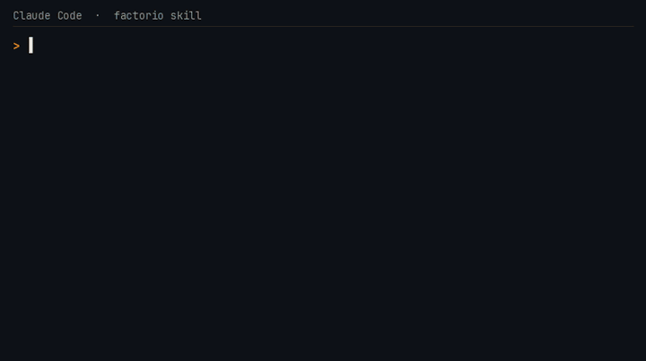

# Factorio skill for Claude Code

**Blueprints that are tested before you paste them.** A [Claude Code](https://claude.com/claude-code) skill
for Factorio 2.0 and 2.1 that answers from your game's real files and runs a headless copy of the game to check
its work, instead of guessing from what it remembers about 1.1.

[Leer en español](README.es.md) · Current version: 1.3.0 ([changelog](CHANGELOG.md))



## What it does

- **Designs blueprints and proves they work.** Claude writes a generator, renders the layout, then builds
  it in an isolated headless Factorio, feeds the belts and measures output per minute. It only hands the
  blueprint over when every machine is working, no inserter faces the wrong way and the rate matches the
  maths. Then it copies the string to your clipboard: Ctrl+V in game.
- **Reads your save.** "What should I do next?" gets an answer based on *your* map: production vs.
  consumption per minute, idle labs, machines without power, ore left, free ore nearby and whether there
  are nests next to it, oil well yields, evolution, turrets and ammo.
- **Works with your base.** Export a part of your factory as a blueprint, draw your whole base as a map,
  or try a blueprint on a copy of your save with the real terrain (pumpjacks on your oil, drills on your
  ore).
- **Decodes any blueprint string or factoriobin link**: book tree, bill of materials, ASCII drawing.
- **Answers from the game files**: recipes, research trees, entity stats, keybinds (including your own
  remaps and your mods'), the names in *your* game language, the Lua API docs that ship with your version.
- **Manages mods**: search the portal, show what a mod really does, install with dependencies and sha1
  check, enable or disable.
- **Remembers your factory** between sessions in a notes file in your Factorio folder.

Your saves are never modified: every tool works on a copy, in a throwaway Factorio instance with its own
config, so it can run while you play.

## Example

> **You:** I need steel. I have a yellow belt of iron plates and some coal.
>
> **Claude:** *(writes a generator, renders it, simulates it)* Here's a book with x16, x24 and x48
> versions plus the head and an extension segment. Iron enters top left (both lanes are fine), coal top
> right, steel leaves through the centre. Simulated: the x24 makes 91 steel/min (90 expected) and lets
> 452 iron/min continue down your line. It's in your clipboard — press Ctrl+V in game.

That blueprint and the exact commands are in [`examples/`](examples/).

The clip at the top is a different, simpler blueprint: the one-command preset (`bp_make.py smelter --ore
iron-plate --n 24`). Its quick 3-minute test reports 84 steel/min because the belts are still filling for
the first two minutes; from minute 3 on all 24 furnaces work and it makes the calculated 90/min (811 plates
in the following 9 minutes of simulation).

## Install

You need [Claude Code](https://claude.com/claude-code), Python 3.8+ and Factorio 2.0 or 2.1 installed on the same
computer (Steam, standalone or installer; Linux, Windows or macOS).

**As a plugin** (recommended, gets updates):

```
/plugin marketplace add AleCadz/factorio-skill
/plugin install factorio@factorio-skill
```

**As a personal skill** (copy the folder):

```sh
git clone https://github.com/AleCadz/factorio-skill
cp -r factorio-skill/skills/factorio ~/.claude/skills/factorio
```

Then just talk to Claude about your factory. To check the setup, ask it to "run the Factorio environment
check", or run it yourself:

```sh
python3 ~/.claude/skills/factorio/scripts/fenv.py
```

### Finding the game

The install and your data folder (saves, mods, settings) are detected automatically, the same way the game
does it: the standalone zip in `~/Games/factorio` or `~/factorio`, Steam libraries (including extra library
folders and Flatpak Steam), the Windows installer, `/Applications/factorio.app` on macOS. If yours is
elsewhere, set:

| Variable | Meaning |
|---|---|
| `FACTORIO_ROOT` | Install folder, the one containing `data/` and `bin/` (on macOS, `factorio.app`) |
| `FACTORIO_DATA` | Your write-data folder: `~/.factorio`, `%APPDATA%\Factorio`, `~/Library/Application Support/factorio`, or the install folder for the standalone zip |

### Optional

- **Clipboard**: `wl-clipboard` (Wayland), `xclip` or `xsel` (X11) on Linux. macOS and Windows work out
  of the box. Without one, blueprints are saved to a file you can open and copy.
- **Installing mods** needs you to be logged in to the mod portal in game (Mods → Log in). Your token is
  read from `player-data.json`, used only for downloads from mods.factorio.com, and never printed.
- **`curl`** for mod downloads (preinstalled on macOS, Windows 10+ and most Linux distributions).

## How it works

Factorio can run without graphics. The scripts start it with a temporary config, a temporary write-data
folder and a tiny helper mod whose `control.lua` does the work: build the blueprint on a lab-tile surface,
revive the ghosts, connect the poles, add an infinite power source, push items onto the input belts,
empty the outputs and log machine states every few seconds. The game's `--benchmark` mode runs it as fast
as your CPU allows, so several simulated minutes take a few seconds.

| Script | What it's for |
|---|---|
| `fenv.py` | Finds the game and your data folder; prints a setup report |
| `bp.py` | Decode, encode, summarize, render, extract from books, fetch from factoriobin, copy to clipboard |
| `bp_make.py` | Make a standard block (smelter, assembler line, green circuits...) and test it in one command; ratio trees |
| `layout.py`, `blocks.py` | Library for custom blueprints: placement by tile, collisions, belt router, auto power, tested blocks |
| `bp_sim.py` | Simulate a blueprint and measure it |
| `bp_probe.py` | Ask the game how a setting is stored in a blueprint |
| `bp_map.py` | PNG map of a blueprint, even a whole base |
| `data.py` | Recipes, technologies, entities, localized names (from a `--dump-data` of your install) |
| `save_probe.py` | Report on your save |
| `save_export.py` | Export part of your save as a blueprint |
| `save_bp_test.py` | Build a blueprint on a copy of your save, at real coordinates |
| `save_advise.py` | What is holding your factory back: root causes traced from starved machines, limiting science pack, next steps |
| `save_map.py` | Map survey: ore patches, oil, nests, charted area; PNG/ASCII maps; judge a seed with `--new-map` |
| `save_diag.py`, `save_trace.py`, `save_lua.py` | Locate problems, follow a belt, run any Lua on a copy of your save |
| `save_sim.py` | Run your base N minutes ahead with blueprints pasted in, built instantly or by your own robots (`--robots`) |
| `chain.py` | Compile a multi-recipe chain (a science pack from plates) into one tested blueprint |
| `rails.py` | Lay rails with the game's own planner; trains, stations and schedules via `layout.py`/`blocks.py` |
| `mods.py` | Mod portal search, info, install, enable, disable |

`skills/factorio/SKILL.md` tells Claude when to use each one and what a passing simulation looks like.

## Privacy and safety

- **No telemetry, no accounts, no dependencies**: plain Python standard library, nothing to `pip install`.
- **Network**: only two commands go online, and only when you ask for them. `mods.py` talks to
  mods.factorio.com (search, info, download) and `bp.py fetch` downloads a blueprint from factoriobin.com.
  Everything else runs offline.
- **Your portal token** is read from `player-data.json` only by `mods.py install`, sent only to
  mods.factorio.com over https, and never printed, logged or stored anywhere else.
- **Your saves are opened as copies** in a temp folder that is deleted afterwards. The only things written
  to your Factorio folder are the blueprints you ask for (`blueprints/`), the notes file
  (`claude-notes.md`) and, when you install or toggle a mod, `mods/`.
- Downloaded mods are checked against the sha1 the portal publishes before replacing anything.

## Limits

- Verified on Factorio 2.0.77 and 2.1.24 **without Space Age**. With the DLC the tools load it and
  `save_probe.py --surface` can read each planet, but quality, planets and the new machines haven't been
  tested yet. Reports are welcome.
- The simulation surface has no ore or water: mining and offshore pumps are tested on a copy of your save
  with `save_bp_test.py` instead.
- Trains: one-way loops with in-line stations only (no junctions, chain-signal layouts or fluid wagons).
- No dedicated tools for circuit networks yet.
- Each tool that runs the game needs a few seconds to load it.

## Tests

```sh
python3 tests/test_offline.py        # no game needed
```

## Contributing

Issues and pull requests are welcome, especially Space Age testing, Windows/macOS reports and new
verified entries for `references/blueprint-format.md`.

## License

MIT. Not affiliated with Wube Software or Anthropic. Factorio is a trademark of Wube Software.

By [AleCadz](https://mods.factorio.com/user/AleCadz), who also made
[Early Blueprints](https://mods.factorio.com/mod/early-blueprints).
